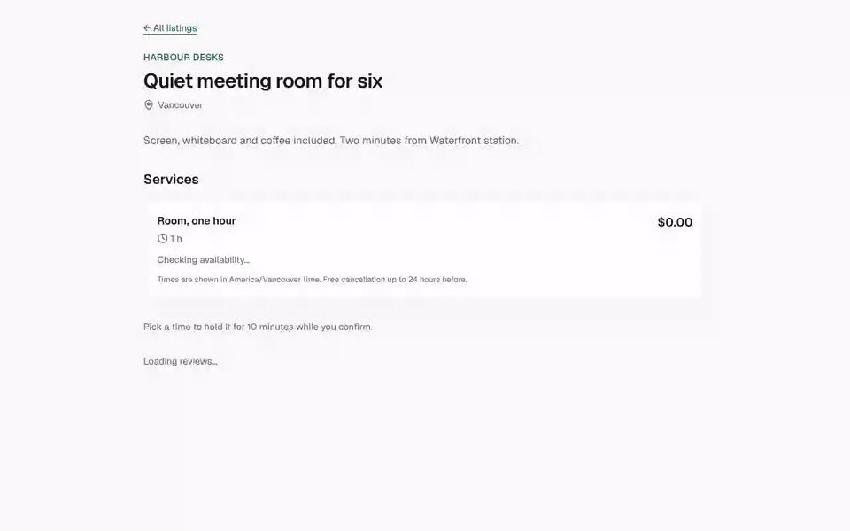
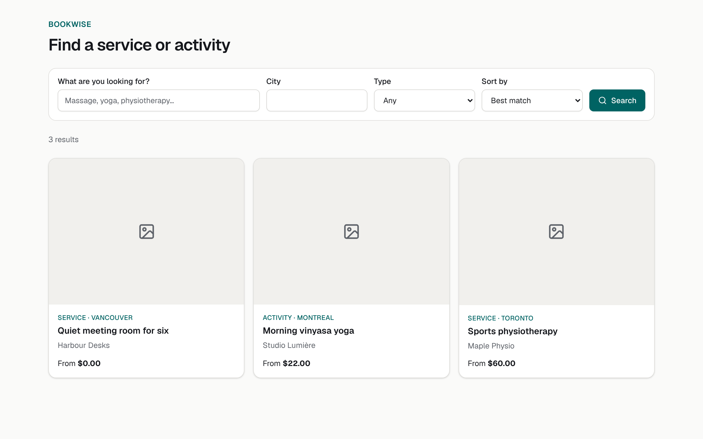
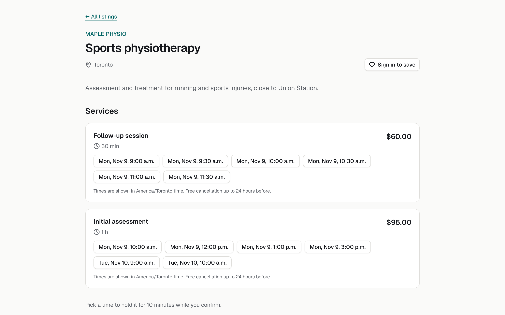
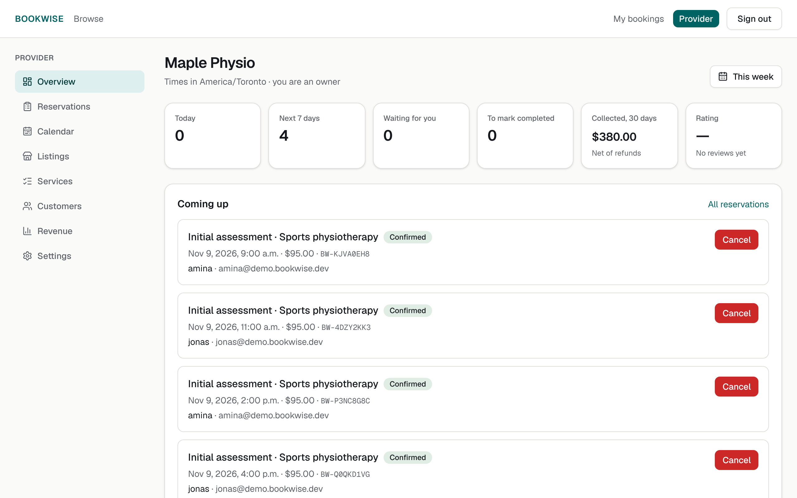
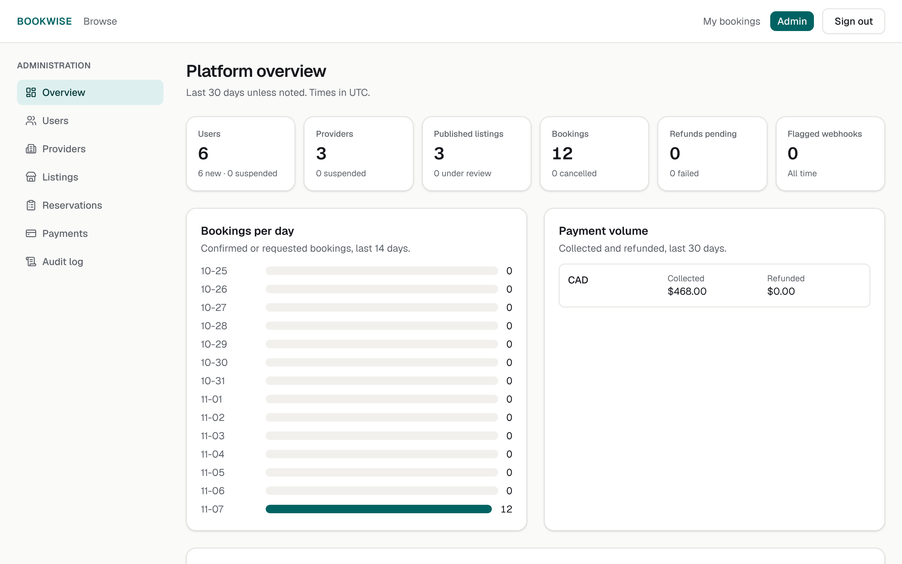
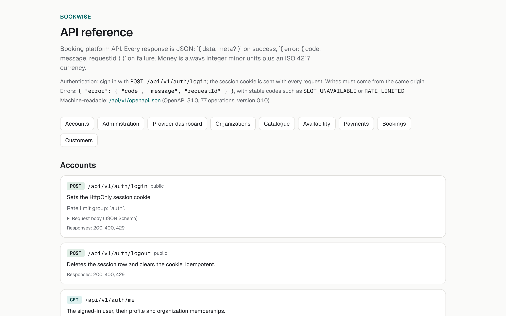

# BookWise

A reservation and booking platform for professional services and activities, built to show
production-grade full-stack engineering: a booking engine that cannot oversell, verified and
idempotent payments, tenant isolation enforced by PostgreSQL row-level security, and a full
automated test suite.

> **Status: complete (all 10 phases).** BookWise is a portfolio project: it runs fully on a
> laptop in demo mode, with a local payment simulator that signs its webhooks exactly like
> Stripe, a local mailbox for emails, and seeded demo data (`npm run seed:demo`). Going live
> with real Stripe test payments, Resend email and Sentry is configuration only; the steps are
> in [docs/deployment.md](docs/deployment.md).



| | |
|---|---|
|  |  |
| Search, in the provider's time zone | Next open times per service |
|  |  |
| Provider dashboard | Platform administration |

## What works today

- Customer and provider registration, email verification, sign-in and sign-out, password
  reset (signs out every device), and a profile.
- Organizations with `owner` and `staff` members; a provider can only ever see their own
  organization (404 for anyone else's).
- Administrators list users, and suspend or reinstate users (all sessions revoked at once)
  and organizations, with a reason recorded in an append-only audit log.
- Providers create listings and services (prices in integer minor units, in the
  organization's currency), upload images (checked by their bytes, re-encoded to WebP, EXIF
  removed), set weekly opening hours and closures, and publish. Administrators can reject or
  restore listings.
- Visitors search by words, type, city and price, sort and page through results, and see
  the next open times, computed in the provider's time zone and correct across daylight
  saving changes.
- Customers pick a time and it is held for 10 minutes. Free bookings confirm at once (or
  wait for the provider's approval); paid ones wait for card payment (Phase 6). Customers
  cancel inside the provider's policy; providers approve, reject, cancel and complete.
- Paid bookings are confirmed only by a signature-verified, deduplicated payment webhook.
  Approval services authorize the card and capture it when the provider accepts. Cancellations
  refund automatically; a payment that arrives after the hold expired re-confirms the booking
  if the time is still free and is refunded otherwise. A reconcile job retries refunds and
  catches lost webhooks.
- **No overselling, proven:** 25 customers request the last seat at the same moment and
  exactly one gets it. A nightly workflow runs that test 50 times in a row.
- Every request that creates something takes an `Idempotency-Key`, so retries never book
  twice. Unpaid holds expire through a delayed job, a one-minute sweeper, and inside the next
  booking's transaction, so the worker being down never blocks a seat.
- **Three dashboards on real data.** Customers: overview, upcoming, history, saved listings,
  reviews, profile and settings (including password change, which signs out other devices).
  Providers: overview with what needs action, reservations (approve, decline, complete,
  cancel with a reason), a weekly calendar with closures, listings, services and opening
  hours, customers, revenue per month and per service net of refunds, and team settings.
  Administrators: platform overview, users, providers, listing and review moderation, all
  reservations, payments with webhook events to review, and the filterable audit log. Every
  view has loading, empty and error states and is tested at 360, 768 and 1280 px.
- Customers review completed bookings (one each, enforced in the database) and save listings.
  Administrators can hide a review with a reason; hidden reviews leave public ratings.
- **Emails that are never lost or doubled.** Confirmations, approval requests, declines,
  cancellations, refunds, late-payment notices and 24-hour reminders are written to an
  outbox table in the same transaction as the booking change. The worker delivers them with
  retries and backoff; a unique key per event means an email is queued once, and the row id
  is the email provider's idempotency key, so a worker that crashes mid-send never delivers
  twice. Failed emails surface on the admin dashboard.
- **Hardened:** rate limits on every endpoint (stricter for sign-in, holds and payments),
  routes private by default, Content-Security-Policy and security headers on every page, and a
  [performance pass](docs/performance.md) that made the slowest dashboard queries up to 200×
  faster at 120,000 bookings.
- **Error reporting ready for Sentry:** unexpected server, worker and browser errors are
  reported with the request id and no personal data, once a DSN is configured.
- PostgreSQL row-level security and guard triggers repeat every rule, so the database still
  protects tenants if application code forgets a check.

### API (v1)

63 REST endpoints, documented from the same Zod schemas that validate them: browse the
reference at `/docs/api` when the app is running, or load `/api/v1/openapi.json` (OpenAPI 3.1)
into any client. `npm run openapi` regenerates it, and a test fails if the committed copy is
out of date.



Create the first administrator from the command line (there is no API for it):
`npm run admin:create -- --email you@example.com` (the account must have confirmed its email).

## Design documents

| Document | Contents |
|---|---|
| [Architecture](docs/architecture.md) | Stack, modules, request pipeline, booking engine, jobs, deployment |
| [Booking lifecycle](docs/booking-lifecycle.md) | State machine, transition rules, late payments, idempotency |
| [Database design](docs/database-design.md) | Entity relationships, tables, constraints, inventory integrity, RLS |
| [Security model](docs/security.md) | Threats, authentication, authorization matrix, payments, uploads, test plan |
| [Performance](docs/performance.md) | Query plans and timings at 120,000 bookings |
| [Deployment](docs/deployment.md) | Render + Upstash setup, zero-downtime deploys, backups, recovery drills |
| [Roadmap](docs/roadmap.md) | Ten phases with exit criteria and test targets |
| [Decision records](docs/adr) | Why the main choices were made |

## Stack

Next.js 16 (App Router) · React 19 · TypeScript (strict) · Tailwind CSS 4 · shadcn/ui ·
Drizzle ORM · PostgreSQL 17 · Better Auth · Redis + BullMQ · Stripe · Resend · Sentry ·
Vitest · Playwright · axe-core · Docker · GitHub Actions

## Run it locally

Requirements: Node.js 22+, Docker.

```bash
docker compose up -d postgres redis mailpit   # PostgreSQL 17 with roles, Redis, Mailpit
cp .env.example .env.local                    # then set BETTER_AUTH_SECRET
cp .env.test.example .env.test
npm ci
npm run db:migrate                            # uses DATABASE_MIGRATION_URL from your shell
npm run dev                                   # http://localhost:3000 (emails: http://localhost:8025)
npm run worker:dev                            # background worker, in a second terminal
```

Everything in containers instead: `docker compose --profile app up --build`.

**Demo data:** `npm run seed:demo` on an empty database creates three providers (Toronto,
Montreal, Vancouver), two customers with confirmed bookings, and an administrator, all through
the real API handlers. It prints the accounts; they share one demo password.

## Switching to Stripe

Payments default to `PAYMENT_PROVIDER=fake`, a simulator that the server refuses to run on
anything but a local URL. To use Stripe in test mode:

1. Set `PAYMENT_PROVIDER=stripe`, `STRIPE_SECRET_KEY=sk_test_…` and
   `NEXT_PUBLIC_STRIPE_PUBLISHABLE_KEY=pk_test_…` (live keys are rejected at start-up).
2. Forward webhooks locally with `stripe listen --forward-to localhost:3000/api/v1/payments/webhook`
   and set `STRIPE_WEBHOOK_SECRET` to the `whsec_…` it prints (in production, create an
   endpoint for the same path in the Stripe dashboard).
3. Pay with the test card `4242 4242 4242 4242`, any future date and any CVC.

## Switching to Resend

Emails default to Mailpit locally (`MAIL_TRANSPORT=mailpit`, inbox at http://localhost:8025).
To send real email:

1. In Resend, add a sending domain (for example `mail.example.com`) and create the DNS
   records it lists (SPF, DKIM and, recommended, DMARC).
2. Set `MAIL_TRANSPORT=resend`, `RESEND_API_KEY=re_…` and `MAIL_FROM="BookWise <bookings@mail.example.com>"`.
3. Run the worker (`npm run worker:dev`); it delivers the outbox every 10 seconds.

## Checks

```bash
npm run lint          # ESLint, including module-boundary rules
npm run typecheck     # strict TypeScript
npm run test:unit     # pure logic, no services needed
npm run test:integration   # real PostgreSQL and Redis (bookwise_test database)
npm run build && npm run test:e2e   # Playwright against the production build
```

CI runs all of these plus a dependency audit, a secret scan and the Docker build on every push
and pull request.

## Database roles

The app connects as `bookwise_app`, which is not a superuser, cannot bypass row-level
security, and cannot change the schema. Migrations run as `bookwise_owner`. See
[`scripts/db/create-roles.sql`](scripts/db/create-roles.sql).
