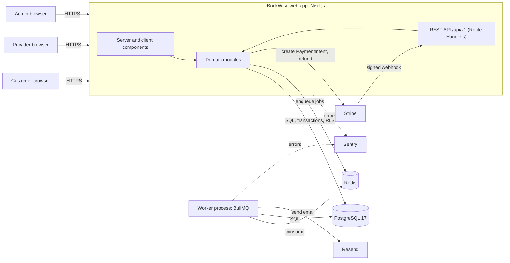
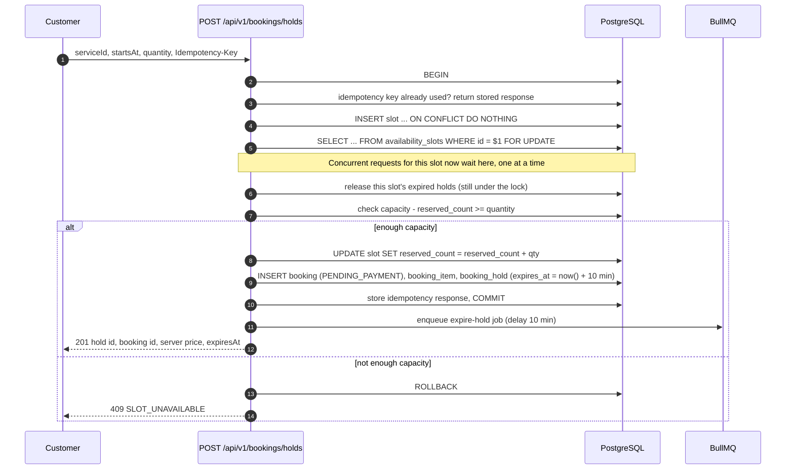
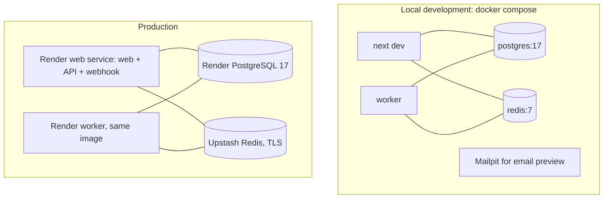

# BookWise — Architecture

Status: **Approved 2026-11-04.** Open decisions were approved: ADR-005 (worker on Render/Railway) and ADR-008
(`AWAITING_APPROVAL` state).

Related documents: [database-design.md](database-design.md) ·
[booking-lifecycle.md](booking-lifecycle.md) · [security.md](security.md) ·
[roadmap.md](roadmap.md)

---

## 1. Goals and non-goals

**Goals**

- A reservation platform where **capacity can never be oversold**, even under concurrent
  requests, duplicate webhooks, and retries.
- Real persistence and real server logic behind every screen. No mock dashboards.
- Clear module boundaries a reviewer can navigate in minutes.
- Security that is enforced on the server and backed by the database (constraints, RLS).
- Reproducible: one `docker compose up` for local development, CI that proves every claim.

**Non-goals for the MVP**

- Accommodation (nightly inventory). It is designed in [database-design.md §8](database-design.md#8-accommodation-later-milestone)
  but built in a later milestone, exactly as the spec requires.
- Multi-currency conversion. Each listing has one ISO currency; amounts are never converted.
- Marketplace payouts to providers (Stripe Connect). Payments go to one platform account in
  test mode. See ADR-006.
- Native mobile apps. The web app is responsive down to 360 px.

---

## 2. Technology stack

Versions are the current stable releases checked on 2026-11-04. They are pinned exactly in
`package.json` and locked in `package-lock.json`. Compatibility is verified in Phase 2 by
installing, type checking and building before any feature work.

| Layer | Choice | Version | Why |
|---|---|---|---|
| Framework | Next.js (App Router) | 16.4.x | Server Components, Route Handlers, one deployable |
| UI runtime | React | 19.3.x | Required by Next 16 |
| Language | TypeScript, `strict` + `noUncheckedIndexedAccess` | 5.9.x | Catch errors at compile time |
| Styling | Tailwind CSS | 4.3.x | Design tokens via CSS variables |
| Components | shadcn/ui (copied source) + Lucide icons | — / 1.68.x | Accessible Radix primitives, owned code |
| Forms | React Hook Form + Zod resolver | 7.91.x / 7.0.x | Same Zod schemas on client and server |
| Validation | Zod | 4.6.x | One schema source of truth per module |
| ORM / migrations | Drizzle ORM + drizzle-kit | 0.45.x / 0.31.x | Typed SQL, raw SQL escape hatch for locks and RLS |
| Database driver | node-postgres (`pg`) | 8.23.x | Mature, supports transactions and `SET LOCAL` |
| Database | PostgreSQL | 17 | Required by spec; CI and Compose use `postgres:17` |
| Auth | Better Auth (Drizzle adapter) | 1.7.x | DB sessions, email verification, password reset |
| Queue | BullMQ on Redis (ioredis) | 6.7.x / 6.0.x | Delayed, retryable, idempotent jobs |
| Payments | Stripe (test mode) | stripe-node 23.x | PaymentIntents, signed webhooks, refunds |
| Email | Resend | 6.x | Transactional email |
| Monitoring | Sentry for Next.js | 11.x | Errors and traces, PII scrubbed |
| Dates | date-fns + @date-fns/tz | 4.x / 1.5.x | IANA time zones and DST-correct slot generation |
| Unit/integration tests | Vitest | 5.1.x | Fast, TypeScript-native |
| E2E tests | Playwright + @axe-core/playwright | 1.64.x / 4.14.x | Real browser journeys + accessibility |

---

## 3. System context



Two deployable processes share one codebase:

1. **Web** (Next.js): pages, REST API, Stripe webhook endpoint.
2. **Worker** (plain Node entry point, `src/jobs/worker.ts`): BullMQ consumers for hold
   expiry, emails, reminders and payment reconciliation.

**PostgreSQL is the only source of truth.** Redis holds job queues and rate-limit counters.
Losing Redis can delay an email. It can never corrupt a booking.

---

## 4. Modular monolith

### 4.1 Modules

| Module | Owns (tables) | Responsibility |
|---|---|---|
| `auth` | users, sessions, accounts, verifications | Better Auth configuration, session lookup, `requireUser()` / `requireRole()` |
| `users` | customer_profiles | Profile, settings, saved listings |
| `organizations` | organizations, organization_members, provider_profiles | Provider onboarding, membership, org time zone, suspension |
| `listings` | listings, listing_images, services, resources | Catalogue, search, publishing, image upload validation |
| `availability` | availability_rules, unavailable_periods, availability_slots | Rules → slot generation, capacity queries |
| `bookings` | bookings, booking_items, booking_holds, idempotency_keys | Holds, inventory allocation, state machine, cancellation |
| `payments` | payments, payment_events, refunds | PaymentIntents, webhook verification, refunds, reconciliation |
| `notifications` | notifications | Templated emails, de-duplication, delivery status |
| `reviews` | reviews | Reviews after `COMPLETED` bookings only |
| `admin` | — (reads across modules through their services) | Platform statistics, suspensions, refunds by admin |
| `audit` | audit_logs | Append-only record of security-relevant actions |

### 4.2 Layers inside a module

```
src/modules/bookings/
├── bookings.schemas.ts      Zod input/output schemas (shared with forms)
├── bookings.service.ts      Business rules and use cases. The only public entry point.
├── bookings.repository.ts   SQL via Drizzle. No business rules.
├── bookings.state.ts        Pure state machine (unit-tested without a database)
├── bookings.pricing.ts      Pure price calculation in minor units
├── bookings.policies.ts     Who may do what (pure functions over actor + resource)
├── bookings.jobs.ts         Job payload types and enqueue helpers
└── index.ts                 Re-exports the service and public types only
```

**Dependency rules** (enforced with ESLint `no-restricted-imports` in Phase 2):

1. Route Handlers and Server Components call **services only**, never repositories.
2. A module imports another module only through its `index.ts`.
3. Repositories never call other repositories across modules. Cross-module work happens in
   a service, inside one transaction passed down as `tx`.
4. React components never import `db`, repositories or secrets.
5. `bookings.state.ts`, `*.pricing.ts` and `*.policies.ts` are pure and have no I/O.

### 4.3 Request handling

Every Route Handler follows the same pipeline, implemented once in `src/lib/http/handler.ts`:

```
rate limit → resolve session → parse + validate input (Zod) → call service
→ map result/error to the standard response → structured log line (request id, user id, status, duration)
```

**Response format**

```jsonc
// success
{ "data": { ... }, "meta": { "page": 1, "pageSize": 20, "total": 134 } }
// error
{ "error": { "code": "SLOT_UNAVAILABLE", "message": "This time is no longer available.", "requestId": "req_..." } }
```

Errors are typed (`AppError` with a stable `code` and HTTP status). Unknown errors become
`500 INTERNAL_ERROR` with a request id. Stack traces and SQL never reach the client.

### 4.4 Database access and tenant context

All tenant-scoped work runs inside a helper that opens a transaction and sets the RLS
context for that transaction only:

```ts
// src/db/with-actor.ts (sketch)
export function withActor<T>(actor: Actor, fn: (tx: Tx) => Promise<T>): Promise<T> {
  return db.transaction(async (tx) => {
    // set_config(..., true) is transaction-local (like SET LOCAL), so a pooled
    // connection can never carry one user's context into the next request.
    await tx.execute(sql`
      select set_config('app.user_id', ${actor.userId}, true),
             set_config('app.role',    ${actor.role},   true)`);
    return fn(tx);
  });
}

// usage in a Route Handler
const hold = await withActor(actor, (tx) => bookingsService.createHold(tx, input));
```

Details and policies are in [database-design.md §6](database-design.md#6-row-level-security).

---

## 5. Booking engine (highest priority)

Full state machine, transitions, and failure handling: [booking-lifecycle.md](booking-lifecycle.md).

### 5.1 Inventory model (MVP: services and activities)

- **Availability rules** describe recurring opening hours in the provider's local time
  (for example "Tuesdays 09:00–17:00, 60-minute slots, capacity 1").
- **Slots** are generated from rules minus unavailable periods, converted to UTC using the
  organization's IANA time zone (DST-safe).
- A slot row is **materialized lazily** the first time someone holds it
  (`INSERT ... ON CONFLICT DO NOTHING` on `(service_id, starts_at)`). Unbooked future
  slots exist only as computed results, so the table does not fill with millions of empty rows.
- Each slot row stores `capacity` and `reserved_count`. A database `CHECK` guarantees
  `0 <= reserved_count <= capacity` regardless of application bugs.

### 5.2 Creating a hold (the critical section)



Why this is safe:

- `SELECT ... FOR UPDATE` serializes all writers on the same slot row.
- The `CHECK` constraint is a second line of defence. Even a buggy update cannot make
  `reserved_count` negative or larger than capacity; the transaction fails instead.
- Expired holds on the slot are released **inside the same locked transaction** before the
  capacity check. Correctness never depends on the Redis expiry job running on time.
- Prices are computed on the server from the service row. The client never sends a price.
- The enqueue happens after `COMMIT`. If Redis is down, the periodic sweeper (§7) still
  expires the hold, and the next hold on that slot releases it anyway.

**Idempotency details (as built).** The key row is inserted in the same transaction as the
booking, so a concurrent request with the same key waits on the primary key and then replays
the stored response. Only successful responses are stored: if the request fails (for example
`409 SLOT_UNAVAILABLE`), its claim rolls back and a retry is evaluated afresh.

**Proof (Phase 5, passing):** an integration test fires at least 20 concurrent hold
requests at a slot with 1 remaining seat (real PostgreSQL, separate connections) and asserts
exactly one `201`, nineteen `409`, `reserved_count = capacity`, and no negative values.

### 5.3 Payment confirmation

A booking becomes `CONFIRMED` only when a **signature-verified** Stripe webhook
(`payment_intent.succeeded`) is processed. The browser's "payment succeeded" redirect only
shows a "confirming…" page that polls the booking status.

Webhook processing is idempotent: `payment_events.stripe_event_id` is `UNIQUE`, the event is
inserted first, and a duplicate delivery hits the constraint and returns `200` without side
effects. The late-payment rule (payment succeeds after the hold expired) is described in
[booking-lifecycle.md §5](booking-lifecycle.md#5-late-payment-reconciliation).

---

## 6. Frontend architecture

- **Route groups**: `(public)`, `(customer)`, `(provider)`, `(admin)`. Each protected group
  has a server-side layout that calls `requireRole()` and redirects. **Hiding a link is never
  the security boundary**; every API route repeats the check.
- **Server Components** fetch through services for first render. **Client components** call
  the REST API for mutations, using React Hook Form with the module's Zod schema.
- Every data view has loading (Suspense skeleton), empty, error (error boundary with retry)
  and success states. Mutations show a toast and keep form input on failure.
- **Design**: neutral palette, one accent colour, Inter or Geist for text, generous spacing,
  4/8 px scale, motion limited to 150–200 ms transitions and disabled under
  `prefers-reduced-motion`. Light and dark themes from CSS variables.
- **Accessibility target**: WCAG 2.2 AA. axe-core runs on every main page in E2E tests;
  any serious or critical violation fails CI.

---

## 7. Background jobs

| Queue / job | Trigger | Idempotency rule |
|---|---|---|
| `holds.expire` | Delayed job at hold creation (10 min) | Transitions only `PENDING_PAYMENT` bookings whose hold is past `expires_at`; no-op otherwise |
| `holds.sweep` | Repeatable job every minute | Same SQL as above for any missed holds |
| `notifications.send` | After booking confirmed / cancelled / refunded | Unique `(booking_id, type)` row in `notifications`; send only if `status = 'pending'` |
| `reminders.schedule` | On confirmation, delayed to 24 h before start | Checks the booking is still `CONFIRMED` before sending |
| `payments.reconcile` | Repeatable job every 15 min | Compares stuck `PENDING_PAYMENT` bookings against Stripe and applies the same transition code as the webhook |
| `providers.notify` | New booking or cancellation | Same unique-notification rule |

All jobs: 5 attempts, exponential backoff (2 s base), job ids derived from the business key
(for example `expire:${holdId}`) so double-enqueueing is harmless. **Jobs re-read the
database before acting and never trust their payload as current state.**

---

## 8. Deployment topology



**ADR-005 (accepted): where the worker runs.** Vercel functions are short-lived and
cannot host a BullMQ worker. The worker must run as a long-lived container. Options:

| Option | Cost | Notes |
|---|---|---|
| Render / Railway / Fly.io background worker | Free tier or ~5 USD/month | Needs an account you create |
| Run worker only in Docker Compose; in production, Vercel Cron calls `/api/internal/cron/sweep` every minute | Free | Hold expiry and reconciliation still work (DB-driven); email/reminder jobs run in the sweep instead of BullMQ in production |

**Decision:** option 1 (Render or Railway). Option 2 remains a documented fallback.

**Update (Phase 10):** the web app runs on Render too, from the same image as the worker, so
one Blueprint ([`render.yaml`](../render.yaml)) describes everything and uploaded images can
live on a persistent disk. Running the web app on Vercel instead needs only object storage for
images behind `src/lib/storage.ts`. Step-by-step setup, backups and recovery:
[deployment.md](deployment.md).

**Managed services you will need accounts for** (all have free tiers): Stripe (test mode),
Resend (with a verified sending domain, for example `mail.sadiatoure.dev`), Sentry, a managed
Redis (Upstash or Redis Cloud), and PostgreSQL 17. For PostgreSQL I can reuse the existing
Supabase project in a new `bookwise` schema with dedicated roles, the same pattern as the
other demos.

---

## 9. Architecture decision records

Short versions here; each becomes a file in `docs/adr/` during Phase 2.

| ADR | Decision | Rationale |
|---|---|---|
| 001 | Modular monolith in one Next.js app plus one worker entry point | One deployable, clear boundaries, no network hops inside a transaction |
| 002 | PostgreSQL row locks + CHECK constraints for inventory; Redis never used for booking consistency | Required by spec; locks are transactional and survive Redis loss |
| 003 | Lazy slot materialization with `UNIQUE (service_id, starts_at)` | Avoids pre-generating huge slot tables; still lockable per slot |
| 004 | Better Auth owns `users/sessions/accounts/verifications`; BookWise owns organizations and roles | Use Better Auth for what it is good at, keep authorization in our code and RLS |
| 005 | Worker runs as a container on Render or Railway | Vercel cannot host long-lived BullMQ workers; see §8 |
| 006 | Single platform Stripe account, no Connect payouts in MVP | Keeps scope realistic; Connect documented as a future milestone |
| 007 | Money as `integer` minor units + `char(3)` currency, never floats | Exact arithmetic; spec requirement |
| 008 | Provider approval flow adds a state `AWAITING_APPROVAL` | The spec's state list has no place for "requires approval"; see [booking-lifecycle.md §3](booking-lifecycle.md#3-states) |
| 009 | API versioned under `/api/v1`, OpenAPI 3.1 generated from Zod schemas | Docs never drift from validation |

---

## 10. Known risks

| Risk | Mitigation |
|---|---|
| Next.js 16 + Better Auth + Drizzle version friction | Phase 2 exit criterion: clean install, type check, build and a passing auth smoke test before any feature work |
| Time zones and DST produce wrong slots | Pure slot generator with unit tests for DST start/end in several zones |
| Webhook ordering (refund event before success event) | State machine rejects invalid transitions; events are stored and reconciled, not applied blindly |
| RLS + connection pooling leak context | Context set only with transaction-local `set_config(..., true)`; tests assert context is empty after commit |
| Serverless cold starts exhaust DB connections | Use the provider's transaction pooler (port 6543) and a small pool per instance |
| Scope is large | Strict milestones; each ends with real test results before the next starts |
