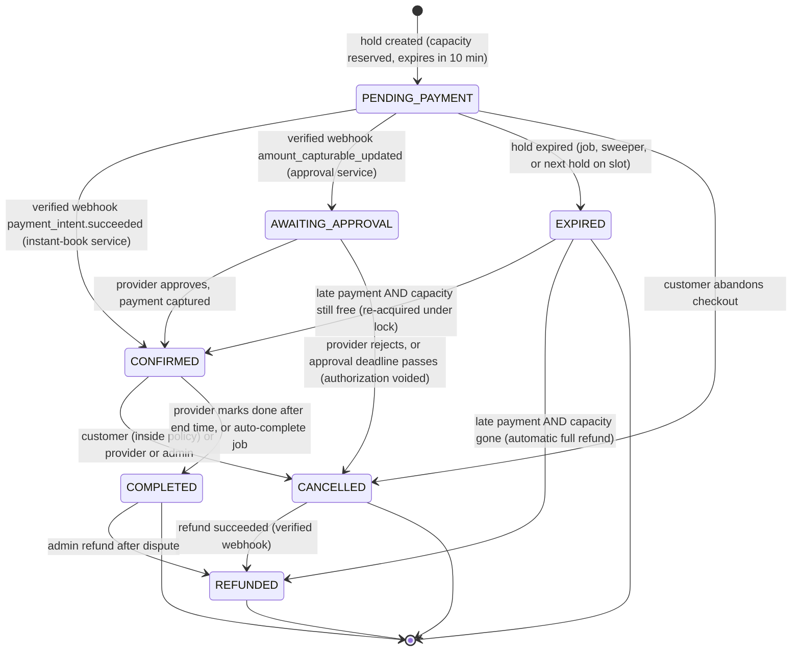
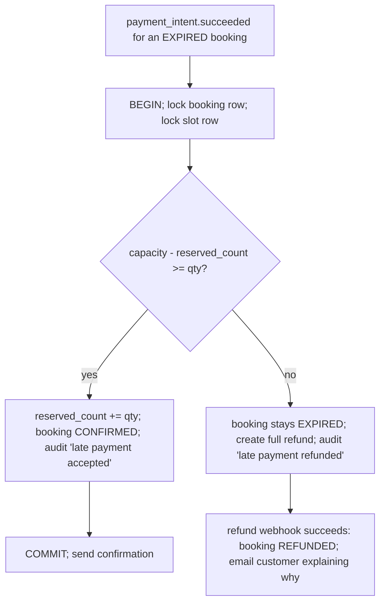

# BookWise — Booking lifecycle

Status: **Proposal (Phase 1)**. Applies to the MVP booking types: professional services and
activities (discrete time slots with capacity). Accommodation uses a different inventory
model, planned in [database-design.md §8](database-design.md#8-accommodation-later-milestone).

---

## 1. Principles

1. **The database is the authority.** A booking's status changes only inside a PostgreSQL
   transaction that also locks the booking row (`SELECT ... FOR UPDATE`).
2. **One function decides every transition.** `bookings.state.ts` exports a pure
   `transition(booking, event, actor)` that returns either the next state plus side effects,
   or a typed error. API routes, webhooks and jobs all call it. Nobody writes `status`
   directly, and no endpoint accepts a status from the client.
3. **Capacity moves with the state.** Every transition that releases capacity decrements
   `availability_slots.reserved_count` in the same transaction.
4. **Every transition is recorded** in `audit_logs` (who, from, to, reason, request id).

---

## 2. State diagram

---

## 3. States

| State | Meaning | Holds capacity? | Terminal? |
|---|---|---|---|
| `PENDING_PAYMENT` | Capacity reserved by a hold; customer is paying | Yes, until `expires_at` | No |
| `AWAITING_APPROVAL` | Payment authorized (not captured); provider must accept | Yes, until approval deadline | No |
| `CONFIRMED` | Paid and allocated | Yes | No |
| `CANCELLED` | Cancelled by someone; refund may be pending | No | Terminal unless a refund follows |
| `EXPIRED` | Hold timed out before payment | No | Terminal unless a late payment arrives |
| `COMPLETED` | Service took place | Yes (historical) | Terminal unless admin refunds |
| `REFUNDED` | Money returned in full | No | Yes |

**[needs approval] `AWAITING_APPROVAL`.** The spec lists six states and also asks for
"accept or reject requests where the offering requires approval". Those two requirements
conflict: an approval request is neither unpaid, nor confirmed. I propose one extra state,
used only by services with `requires_approval = true`. Payment for those uses Stripe's
**manual capture** (the card is authorized at checkout and charged only when the provider
accepts; Stripe authorizations last up to 7 days, so the approval deadline is set to
48 hours). If you prefer to keep exactly six states, the alternative is to drop the approval
feature from the MVP.

---

## 4. Transition rules

Each row is one branch of `transition()`. "Who" is checked on the server against the
actor's role and organization membership.

| From | Event | Who | Guard | To | Side effects (same transaction unless noted) |
|---|---|---|---|---|---|
| — | `HOLD_CREATED` | Customer | Slot locked, `capacity - reserved >= qty`, service published, provider active | `PENDING_PAYMENT` | `reserved_count += qty`; hold `expires_at = now() + 10 min`; enqueue expiry job after commit |
| `PENDING_PAYMENT` | `PAYMENT_SUCCEEDED` | Stripe (verified) | Hold not expired; amount and currency match booking | `CONFIRMED` | Hold marked `converted`; payment `succeeded`; enqueue confirmation emails |
| `PENDING_PAYMENT` | `PAYMENT_AUTHORIZED` | Stripe (verified) | Service requires approval; hold not expired | `AWAITING_APPROVAL` | Hold `expires_at` extended to approval deadline (48 h); notify provider |
| `PENDING_PAYMENT` | `PAYMENT_FAILED` | Stripe (verified) | — | `PENDING_PAYMENT` (unchanged) | Record failure; customer may retry with the same PaymentIntent until the hold expires |
| `PENDING_PAYMENT` | `HOLD_EXPIRED` | System | `now() >= expires_at` | `EXPIRED` | `reserved_count -= qty`; cancel the PaymentIntent at Stripe (after commit) |
| `PENDING_PAYMENT` | `CUSTOMER_CANCEL` | Owner customer | — | `CANCELLED` | `reserved_count -= qty`; cancel PaymentIntent |
| `AWAITING_APPROVAL` | `PROVIDER_APPROVE` | Member of the listing's organization | Before deadline | `CONFIRMED` (after capture webhook) | Capture PaymentIntent; confirmation follows the `PAYMENT_SUCCEEDED` webhook |
| `AWAITING_APPROVAL` | `PROVIDER_REJECT` / `APPROVAL_TIMEOUT` | Provider / System | — | `CANCELLED` | `reserved_count -= qty`; void authorization; notify customer |
| `CONFIRMED` | `CUSTOMER_CANCEL` | Owner customer | `starts_at - now() >= service.cancellation_window` (default 24 h) | `CANCELLED` | `reserved_count -= qty`; create refund (full); notify provider |
| `CONFIRMED` | `PROVIDER_CANCEL` / `ADMIN_CANCEL` | Org member / Admin | Before `starts_at` | `CANCELLED` | Same as above, always full refund |
| `CONFIRMED` | `COMPLETE` | Org member, or System | `now() >= ends_at` | `COMPLETED` | Customer becomes eligible to review |
| `CANCELLED` | `REFUND_SUCCEEDED` | Stripe (verified) | A refund exists for this booking | `REFUNDED` | Refund `succeeded` |
| `COMPLETED` | `ADMIN_REFUND` | Admin | Payment `succeeded`, reason required | `REFUNDED` (after webhook) | Refund created; audit log entry with reason |
| `EXPIRED` | `PAYMENT_SUCCEEDED` | Stripe (verified) | See §5 | `CONFIRMED` or `REFUNDED` | See §5 |

Anything not in this table returns `409 INVALID_TRANSITION` and changes nothing.
Unit tests enumerate every `(state, event)` pair to prove that.

---

## 5. Late payment reconciliation

A payment can succeed after its hold expired (customer paid at minute 9:59, webhook arrived
at minute 10:02, or the PaymentIntent cancel lost a race). The system never confirms
inventory it no longer owns:

---

## 6. Idempotency

| Operation | Mechanism |
|---|---|
| `POST /bookings/holds`, `POST /bookings`, `POST /payments/create-intent` | Required `Idempotency-Key` header. Stored in `idempotency_keys (user_id, key)` with a hash of the request body and the response. Same key + same body returns the stored response; same key + different body returns `422`. Keys expire after 24 h. |
| Stripe PaymentIntent creation | Stripe idempotency key `pi:${bookingId}`; `payments.booking_id` is `UNIQUE`, so a retry returns the existing PaymentIntent |
| Webhook delivery | `payment_events.stripe_event_id UNIQUE`. The event row is inserted first in the transaction; a duplicate violates the constraint and is acknowledged with `200` without side effects |
| Two different successful PaymentIntents for one booking | Impossible: one payment row per booking (`UNIQUE booking_id`), and only that PaymentIntent id is accepted |
| Jobs | Job id = business key (`expire:${holdId}`); handlers re-read state and no-op if the transition no longer applies |
| Refunds | Stripe idempotency key `refund:${bookingId}`; `refunds` has a partial unique index allowing one full refund per payment |

---

## 7. Cancellation and refund policy (MVP)

- Customers can cancel a `CONFIRMED` booking free of charge until the service's
  cancellation window (default 24 hours before start). Inside the window the "Cancel" action
  is hidden **and** the API returns `409 CANCELLATION_WINDOW_PASSED`.
- Providers and admins can cancel any upcoming booking; the customer always gets a full
  refund.
- Partial refunds and cancellation fees are out of scope for the MVP.

---

## 8. Tests that prove this document

| Area | Examples |
|---|---|
| Unit (pure) | Every valid transition; every invalid `(state, event)` pair rejected; cancellation window boundaries; price totals in minor units |
| Integration (real PostgreSQL) | 20+ concurrent holds on the last seat; hold expiry releases capacity; expired hold released by the next hold on the same slot; duplicate webhook is a no-op; late payment accepted vs refunded; refund webhook moves `CANCELLED → REFUNDED`; capacity never negative |
| E2E (Playwright + Stripe test mode) | Customer books, pays with a test card, sees confirmation, cancels inside policy |
