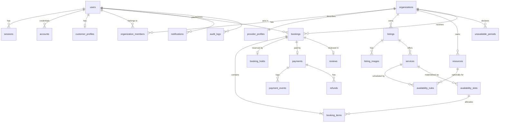

# BookWise — Database design

Status: **Approved 2026-11-04.** PostgreSQL 17, schema managed by Drizzle ORM with
reviewed SQL migrations in `src/db/migrations/`.

---

## 1. Conventions

| Rule | Detail |
|---|---|
| Primary keys | `uuid` with `DEFAULT gen_random_uuid()` |
| Timestamps | `timestamptz` everywhere; `created_at`, `updated_at` (trigger-maintained) |
| Time zones | `organizations.timezone` holds an IANA name (`America/Toronto`), validated against `pg_timezone_names` |
| Money | `integer` minor units (`amount_minor`) + `currency char(3)` (ISO 4217, upper case, `CHECK`) |
| Enums | PostgreSQL enums for closed sets (roles, booking status) so invalid values cannot be stored |
| Soft delete | Only on `listings` and `services` (`archived_at`), so history stays readable. **Never** on bookings, payments, payment events, refunds or audit logs |
| Naming | `snake_case`, plural tables, foreign keys `<entity>_id` |
| Tenant column | Every provider-owned table carries `organization_id` directly (no joins needed for RLS) |

---

## 2. Entity relationships



---

## 3. Tables

Only the important columns are listed; every table also has `created_at` / `updated_at`.

### 3.1 Identity (Better Auth core schema, generated with its Drizzle adapter)

| Table | Key columns | Notes |
|---|---|---|
| `users` | `id`, `email` (unique, lower-cased), `email_verified`, `name`, `role` (`customer` \| `provider` \| `admin`), `status` (`active` \| `suspended`) | `role` and `status` are BookWise additions via Better Auth `additionalFields`; `role` is **not** writable through any public endpoint |
| `sessions` | `id`, `user_id`, `token` (random, unique), `expires_at`, `ip_address`, `user_agent` | Better Auth database sessions; deleting the row logs the user out everywhere |
| `accounts` | `user_id`, `provider_id`, `password` (scrypt hash by Better Auth) | Credential storage |
| `verifications` | `identifier`, `value`, `expires_at` | Email verification and password reset tokens |

### 3.2 Users and organizations

| Table | Key columns | Constraints |
|---|---|---|
| `customer_profiles` | `user_id` (PK, FK), `phone`, `locale`, `marketing_opt_in` | 1:1 with users |
| `organizations` | `id`, `name`, `slug` (unique), `timezone`, `default_currency`, `status` (`active` \| `suspended`), `created_by` | `CHECK timezone IN pg_timezone_names` via trigger |
| `organization_members` | `organization_id`, `user_id`, `role` (`owner` \| `staff`) | PK `(organization_id, user_id)`; at least one owner (trigger) |
| `provider_profiles` | `organization_id` (PK), `description`, `phone`, `address`, `city`, `country` | Public business details |

### 3.3 Catalogue

| Table | Key columns | Constraints |
|---|---|---|
| `listings` | `id`, `organization_id`, `category` (`service` \| `activity` \| `accommodation`), `title`, `description`, `city`, `status` (`draft` \| `published` \| `under_review` \| `rejected`), `archived_at` | Full-text `tsvector` generated column + GIN index for search |
| `listing_images` | `id`, `organization_id`, `listing_id`, `storage_key`, `content_type`, `bytes`, `width`, `height`, `position` | `content_type IN ('image/jpeg','image/png','image/webp')`, `bytes <= 5 MB` |
| `services` | `id`, `organization_id`, `listing_id`, `name`, `duration_minutes`, `price_minor`, `currency`, `pricing` (`per_booking` \| `per_participant`), `capacity`, `max_per_booking`, `requires_approval`, `cancellation_window_hours`, `archived_at` | `price_minor >= 0`, `capacity >= 1`, `duration_minutes BETWEEN 5 AND 1440` |
| `resources` | `id`, `organization_id`, `name`, `kind` (`staff` \| `room` \| `equipment`) | Optional: a service can be tied to a specific practitioner |

### 3.4 Availability and inventory

| Table | Key columns | Constraints |
|---|---|---|
| `availability_rules` | `id`, `organization_id`, `service_id`, `resource_id` (nullable), `weekday` (0–6), `start_local` (`time`), `end_local` (`time`), `slot_interval_minutes`, `valid_from` (`date`), `valid_until` (`date`, nullable) | `end_local > start_local`; times are in the organization's time zone |
| `unavailable_periods` | `id`, `organization_id`, `service_id` (nullable = whole organization), `starts_at`, `ends_at`, `reason` | `ends_at > starts_at`; `EXCLUDE USING gist` prevents overlapping periods for the same scope |
| `availability_slots` | `id`, `organization_id`, `service_id`, `starts_at`, `ends_at`, `capacity`, `reserved_count`, `status` (`open` \| `blocked`) | **`UNIQUE (service_id, starts_at)`**, **`CHECK (reserved_count >= 0 AND reserved_count <= capacity)`** |

### 3.5 Bookings

| Table | Key columns | Constraints |
|---|---|---|
| `bookings` | `id`, `reference` (short public code, unique), `customer_id`, `organization_id`, `service_id`, `status` (enum, see lifecycle), `starts_at`, `ends_at`, `quantity`, `total_minor`, `currency`, `cancellation_reason`, `confirmed_at`, `cancelled_at`, `completed_at` | `total_minor >= 0`, `quantity >= 1`; the price is copied from the service at hold time and never recalculated from client input |
| `booking_items` | `id`, `booking_id`, `organization_id`, `slot_id`, `quantity`, `unit_price_minor` | `quantity >= 1`; one item per slot in the MVP |
| `booking_holds` | `id`, `booking_id` (unique), `slot_id`, `quantity`, `expires_at`, `status` (`active` \| `converted` \| `released`) | Partial index on `(slot_id) WHERE status = 'active'` for fast expired-hold release |
| `idempotency_keys` | `user_id`, `key`, `request_hash`, `response_status`, `response_body` (jsonb), `expires_at` | PK `(user_id, key)` |

### 3.6 Payments

| Table | Key columns | Constraints |
|---|---|---|
| `payments` | `id`, `booking_id` (**unique**), `organization_id`, `stripe_payment_intent_id` (unique), `amount_minor`, `currency`, `capture_method` (`automatic` \| `manual`), `status` (`requires_payment` \| `authorized` \| `succeeded` \| `failed` \| `canceled`) | Amount must equal `bookings.total_minor` (checked in the service; asserted in tests) |
| `payment_events` | `id`, `payment_id` (nullable), `stripe_event_id` (**unique**), `type`, `payload` (jsonb), `processed_at`, `processing_error` | Insert-first idempotency for webhooks; never deleted |
| `refunds` | `id`, `payment_id`, `booking_id`, `stripe_refund_id` (unique), `amount_minor`, `reason`, `status`, `requested_by` | Partial unique index: one non-failed full refund per payment |

### 3.7 Engagement and audit

| Table | Key columns | Constraints |
|---|---|---|
| `reviews` | `id`, `booking_id` (**unique**), `listing_id`, `customer_id`, `rating`, `comment` | `rating BETWEEN 1 AND 5`; insert allowed only when the booking is `COMPLETED` and owned by the author (service check + RLS) |
| `notifications` | `id`, `user_id`, `booking_id`, `type`, `channel` (`email`), `status` (`pending` \| `sent` \| `failed`), `provider_message_id`, `sent_at` | **`UNIQUE (booking_id, type, user_id)`** stops duplicate emails |
| `audit_logs` | `id` (bigint identity), `actor_user_id`, `actor_role`, `organization_id`, `action`, `entity_type`, `entity_id`, `before` (jsonb), `after` (jsonb), `ip_address`, `request_id`, `created_at` | Append-only: the app role has `INSERT` and `SELECT` only; a trigger rejects `UPDATE`/`DELETE` |

---

## 4. Inventory integrity

Overselling is prevented by four independent layers:

1. **Row lock.** Holds lock the slot with `SELECT ... FOR UPDATE` before checking capacity.
2. **Atomic update.** `UPDATE availability_slots SET reserved_count = reserved_count + $qty
   WHERE id = $id AND reserved_count + $qty <= capacity RETURNING reserved_count`.
   Zero rows returned means no capacity.
3. **CHECK constraint.** `reserved_count` can never go below 0 or above `capacity`; a bug
   that tries fails the whole transaction.
4. **Unique constraints.** One slot row per `(service_id, starts_at)`; one hold per booking;
   one payment per booking; one webhook event per Stripe event id.

A nightly consistency check (job + test helper) recomputes `reserved_count` from active holds
and confirmed booking items and reports any drift.

Capacity changes on rules: editing a service's capacity or rules never lowers a
materialized slot below its `reserved_count` (the constraint blocks it). The provider UI
shows affected bookings and asks them to cancel those first.

---

## 5. Key indexes

| Index | Serves |
|---|---|
| `availability_slots (service_id, starts_at)` unique | Lock target, availability lookups |
| `booking_holds (expires_at) WHERE status = 'active'` | Sweeper finds expired holds |
| `bookings (customer_id, starts_at DESC)` | Customer history |
| `bookings (organization_id, starts_at)` | Provider calendar and reservations |
| `bookings (status, starts_at)` | Auto-complete and reminder jobs |
| `listings USING gin (search_vector)` + `(status, category, city)` | Search and filters |
| `audit_logs (organization_id, created_at DESC)` | Admin and provider audit views |

---

## 6. Row-level security

RLS is enabled (and `FORCE ROW LEVEL SECURITY`) on every table that carries
`organization_id` or `customer_id`, plus `reviews` and `notifications`.

**Context.** The application sets, per transaction only:
`app.user_id`, `app.role` (`customer` \| `provider` \| `admin` \| `system`). Helper functions
read them:

```sql
create function app_user_id() returns uuid language sql stable as
  $$ select nullif(current_setting('app.user_id', true), '')::uuid $$;

create function app_is_member(org uuid) returns boolean language sql stable
  security definer set search_path = bookwise as
  $$ select exists (select 1 from organization_members
                    where organization_id = org and user_id = app_user_id()) $$;
```

**Example policies**

```sql
-- Providers see and change only their organization's bookings;
-- customers see only their own; admins see all.
create policy bookings_select on bookings for select using (
  customer_id = app_user_id()
  or app_is_member(organization_id)
  or current_setting('app.role', true) in ('admin', 'system')
);

-- Anyone may read published listings; only members may write.
create policy listings_read  on listings for select using (status = 'published' or app_is_member(organization_id) or current_setting('app.role', true) = 'admin');
create policy listings_write on listings for all    using (app_is_member(organization_id)) with check (app_is_member(organization_id));
```

With no context set (`app.user_id` empty), tenant tables return **zero rows**: RLS fails
closed.

**Database roles**

| Role | Used by | Rights |
|---|---|---|
| `bookwise_owner` | Migrations only (CI and deploy step) | Owns the schema |
| `bookwise_app` | Web app and worker | `NOSUPERUSER NOBYPASSRLS`; DML on app tables; `INSERT, SELECT` only on `audit_logs` and `payment_events` |

The `system` context (webhooks, jobs) is set only by trusted server code paths after
signature or job verification; it is never derived from a request header. RLS here is
defence in depth: the services still filter every query by owner explicitly.

**Tested at both levels**: API tests (provider B gets `404` for provider A's booking) and
database tests that connect as `bookwise_app`, set a context, and query tables directly.

---

## 7. Migrations

- Schema is defined in TypeScript (`src/db/schema/*.ts`); `drizzle-kit generate` produces
  SQL. RLS policies, triggers, `EXCLUDE` constraints and roles live in hand-written SQL
  migrations, because they cannot be expressed in the Drizzle schema.
- Every migration is committed, reviewed, and applied in CI to an **empty** PostgreSQL 17 to
  prove a clean bootstrap. No `drizzle-kit push` outside local experiments.
- Destructive changes follow expand → migrate data → contract across separate releases.

---

## 8. Accommodation (later milestone)

A hotel stay is a **range of nights**, not an appointment. It gets its own inventory table
instead of reusing time slots:

| Table | Key columns | Constraints |
|---|---|---|
| `room_types` | `id`, `organization_id`, `listing_id`, `name`, `max_guests`, `total_rooms`, `nightly_price_minor`, `currency` | `total_rooms >= 1` |
| `room_type_nights` | `room_type_id`, `night` (`date`), `rooms_total`, `rooms_reserved`, `price_override_minor` | PK `(room_type_id, night)`; `CHECK (rooms_reserved BETWEEN 0 AND rooms_total)` |

Booking 3 nights × 2 rooms locks the three `room_type_nights` rows **in ascending date order**
(to avoid deadlocks), checks each one, and increments each one in one transaction. The
booking stores `check_in`, `check_out`, `guests`, `rooms`, and the nightly prices used.
The state machine, payments, and holds are reused unchanged.
